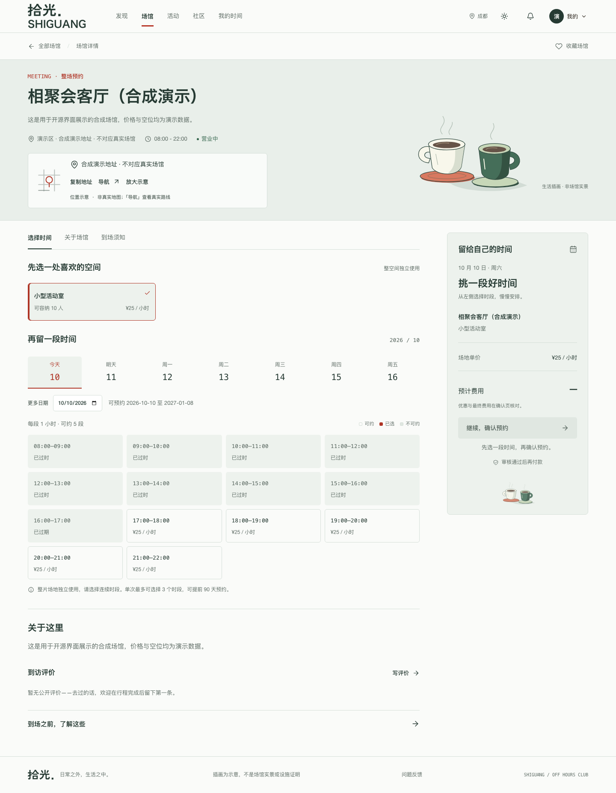
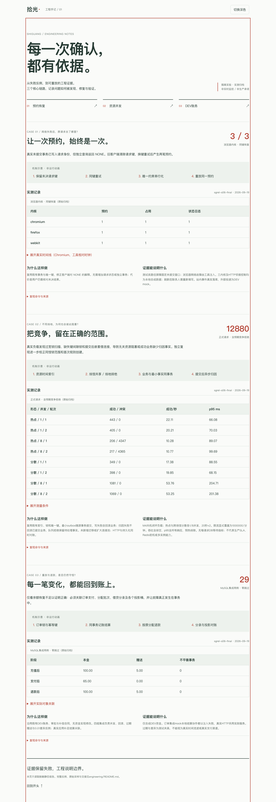

# 拾光 · 综合预约系统

面向场馆、场地、自习室和活动室的全栈预约与社区平台。适合学习完整业务链路、研究预约并发与异常恢复，或作为二次开发的起点。

**当前版本：v0.1.0 开源候选。** 支付与储值以 DEV 合成环境为主；生产部署、多实例长稳和真实资金能力尚未验证。详见[能力边界](docs/limitations.md)。

## 界面预览






截图来自本地演示和合成数据。工程案例页面展示标明版本的历史实验，不是实时监控。

## 核心能力

- 预约：按日期、时段、容量或指定座位分配资源；冲突重校验、取消释放、未支付改期。
- 异常恢复：稳定请求键、重复提交重放、同键异载荷拒绝、响应丢失后核对原请求。
- 订单与履约：DEV 支付、退款、签到、状态记录、通知与后台场馆权限。
- 社区与活动：小组、帖子、治理、活动申请和找搭子。
- 会员与运营：积分权益、优惠券、DEV 储值分账及对账、自营宣传与受控广告归因。

## 快速开始

推荐环境：Java 17、Maven 3.9+、Node.js 24 LTS、npm 10+、Python 3.9+、Docker Compose v2。

```bash
cp .env.example .env.local
npm ci --prefix frontend
./scripts/dev-start.sh
```

| 入口 | 默认地址 |
| --- | --- |
| 用户与管理页面 | http://127.0.0.1:5173 |
| 后端健康检查 | http://127.0.0.1:8080/actuator/health |
| 本地邮件收件箱 | http://127.0.0.1:8025 |

首次迁移会创建演示管理员 `admin`，密码为 `password`。也可以从界面注册普通用户。以上账号和模板凭据仅供环回地址上的本地演示。

停止本地环境：

```bash
./scripts/dev-stop.sh
```

容器模式及配置说明见[本地部署](docs/development.md)。数据卷会保留；重置脚本会删除本地数据，使用前请阅读脚本提示。

## 三个值得复现的工程问题

| 案例 | 研究问题 | 入口 |
| --- | --- | --- |
| C1 预约恢复 | 创建响应丢失、原事务尚未提交时，如何保留请求身份并避免重复预约？ | [实现与实验](engineering/README.md#c1-预约恢复) |
| C2 资源并发 | 如何约束数据库锁范围，并核对成功预约与占用、请求身份、outbox 的一致性？ | [实现与实验](engineering/README.md#c2-资源并发) |
| C3 DEV 账务 | 重复支付、回滚、退款与对账时，分录和资金桶是否仍然一致？ | [实现与实验](engineering/README.md#c3-dev-账务) |

访问 `/engineering` 阅读标明来源的历史实验；按[实验安装说明](engineering/lab/README.md)在独立合成环境重新运行。历史性能数字不能外推为生产容量。

## 技术栈与目录

Vue 3 / TypeScript / Vite / Pinia / Element Plus；Java 17 / Spring Boot 3 / Spring Security / MyBatis-Plus；MySQL / Redis / Flyway；JUnit / Testcontainers / Vitest / Playwright。

```text
backend/       后端、数据库迁移与测试
frontend/      用户端、管理端与前端测试
deploy/        Docker Compose 与 Nginx 配置
engineering/   可复现实验和精选历史报告
docs/          架构、使用边界、开发说明与截图
scripts/       本地启动、检查和依赖审计
licenses/      第三方字体授权原文
```

## 验证与贡献

```bash
npm ci --prefix frontend
npm test --prefix frontend
npm run build --prefix frontend
(cd backend && mvn -B -ntp clean verify)
python3 scripts/check_public_release.py
```

部分储值集成测试需要显式启用和独立 MySQL 数据库，不能把默认跳过记为通过。运行方法见[验证说明](docs/verification.md)。本次候选版本的实际验证记录见[发布检查](docs/release-verification.md)。

贡献前阅读 [CONTRIBUTING](CONTRIBUTING.md)。发现问题可使用 GitHub Issue 模板；安全问题请按 [SECURITY](SECURITY.md) 处理。

## 许可证

项目代码采用 [MIT](LICENSE)。字体和其他第三方依赖保留各自授权，见[第三方声明](THIRD_PARTY_NOTICES.md)。
