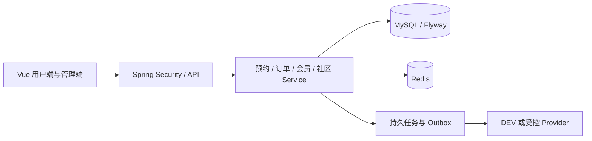

# 架构与关键责任

应用采用 Vue 前端和 Spring Boot 模块化单体后端，MySQL 保存业务权威事实，Redis 提供缓存、限流与协调提示。

前端展示可售与价格，后端在写入时重新判断库存、金额和权限。Redis 提示不能替代数据库中的预约、支付、幂等和账务事实。

## 预约与资源

`ReservationService` 组织创建、取消和未支付改期。请求身份以用户和幂等键为作用域，载荷指纹防止同键改变意图；同键重放在副作用前返回原对象。独立查询未看见未提交事务时，客户端保留原键。

资源按整场独占、容量或指定座位分配。资源时间索引约束锁读范围；场馆共享读锁和场地排他锁降低无关资源阻塞。规则变更仍需要与在途分配协调。

## 金额、订单与异步任务

服务端重算价格并保存快照。支付、退款和储值分录遵守既有事务与幂等合同；页面返回不被当作支付事实。最小 outbox 事实与源业务同事务保存，后续处理可重试。源事务失败与外部送达失败属于不同阶段。

## 授权与治理

Spring Security、叶子权限和场馆范围在服务端强制执行。社区可见性、成员状态、举报和双向屏蔽约束读取与写入；后台页面隐藏控件不替代服务端授权。

代码入口和可复现反例见[工程案例](../engineering/README.md)，环境边界见[限制说明](limitations.md)。
